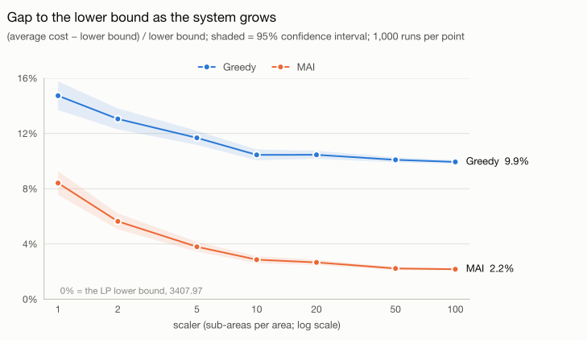
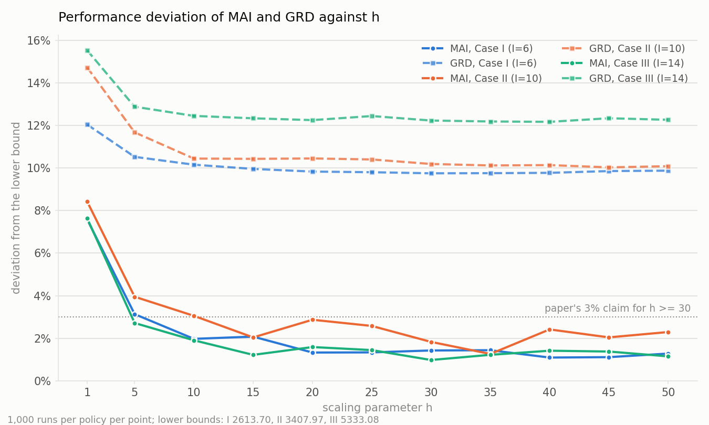
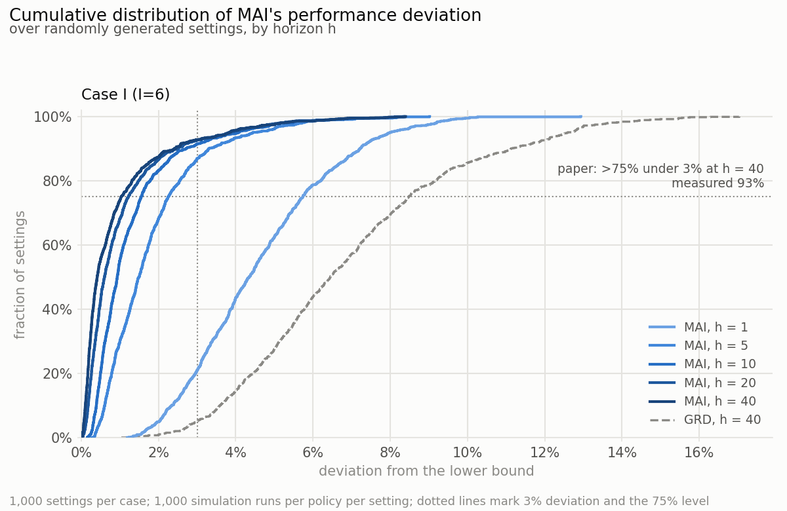
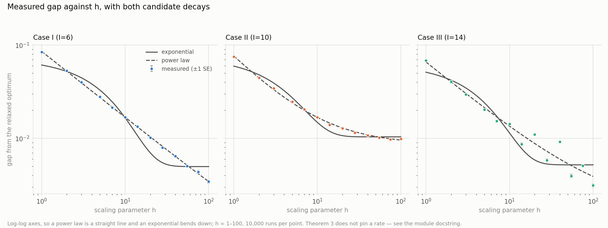

# Coordinated multi-agent patrolling: a Python reimplementation

[](https://doi.org/10.1109/TAC.2024.3517326)
[](https://arxiv.org/abs/2309.13388)


This repository reimplements, in Python, the C++ code that accompanies

> J. Fu, Z. Wang and J. Chen, "Coordinated Multiagent Patrolling With State-Dependent Cost Rates:
> Asymptotically Optimal Policies for Large-Scale Systems," *IEEE Transactions on Automatic Control*,
> vol. 70, no. 6, pp. 3800–3815, June 2025. doi:[10.1109/TAC.2024.3517326](https://doi.org/10.1109/TAC.2024.3517326)
> (preprint: [arXiv:2309.13388](https://arxiv.org/abs/2309.13388)).

The original C++ was written by Jing Fu (RMIT University) and shared by the authors as "code for sharing". It
needs IBM CPLEX, Boost, GMP and MPFR. This reimplementation needs NumPy and SciPy, and solves the linear program
with HiGHS, the open-source solver that ships with SciPy.

The goal was a faithful reimplementation: the same model, the same random-number stream, the same tie-breaking
and the same output files as the C++. When both programs read the same LP solution, the Python reproduces the
C++'s result rows (8 of 10 columns exactly, the other two to the last bit) and its trajectory logs byte for byte.
On top of that, the repository reruns the numerical experiments of the paper's Section VI and records how far
they reproduce.

This is an independent reimplementation. The paper's authors did not write or review it.

## Contents

- [Status](#status)
- [Background](#background)
- [Installation](#installation)
- [Quick start](#quick-start)
- [Output format](#output-format)
- [Results](#results)
- [The value function, and why MAI depends on the LP solver](#the-value-function-and-why-mai-depends-on-the-lp-solver)
- [Verification against the C++](#verification-against-the-c)
- [Where the shared code differs from the paper](#where-the-shared-code-differs-from-the-paper)
- [Known limitations](#known-limitations)
- [Command-line reference](#command-line-reference)
- [Repository layout](#repository-layout)
- [Documentation](#documentation)
- [Citation](#citation)
- [Acknowledgements and licence](#acknowledgements-and-licence)

## Status

| Item | Status | Evidence |
|---|---|---|
| Same output as the C++ on the same LP solution | Reproduced. Scalers 1, 2 and 5 are in the test suite; seven scalers from 1 to 100 are in [benchmarks.md](benchmarks.md) §2 | `tests/test_against_cpp.py` (10 tests) |
| Same output as the authors' own CPLEX build | Reproduced on two CPLEX 22.2 solutions (ARM64 and x86-64) | `tests/data/cpp_reference_cplex*.tsv` |
| Lower bound from the relaxed LP | Matches CPLEX (371.653 + 3036.31 for the two agent types) | `validate_lp.py`, test suite |
| Paper Table II (initial agent placement) | Matches for all three cases with seeds 300, 395 and 51 | `tests/find_paper_seeds.py` |
| Paper Table I (initial risk) | Matches, except one printed entry for Case III (see [departures](docs/departures.md#table-i-case-iii)) | `patrol/generate.py` |
| Figure 3, Case I: MAI under 3% in more than 75% of settings at h = 40 | Reproduced: 92.8% of 1,000 settings | `benchmarks/fig3_case1_full.csv` |
| Figure 3, Cases II and III | Not run | |
| Figure 4: MAI under 3% for h ≥ 30, Greedy flat | Observed at every plotted h from 30 to 50 in all three cases; the input rows are not archived | `benchmarks/fig4.png` |
| Theorem 3 (exponential convergence) | Not testable from finite runs as stated; finite-h measurements are in [benchmarks.md](benchmarks.md) §8 | `analyse_theorem3.py` and related scripts |
| The authors' own published curve values | Cannot be compared: the shared package has no LP solution, run log or figure data | |

[docs/reproduction.md](docs/reproduction.md) gives the detail behind every row.

## Background

A city is divided into I areas connected by a graph. Each area is split into h identical sub-areas, where h is
the paper's scaling parameter (`scaler` in the code). Every sub-area carries a crime risk for each of J = 2 crime
types, held as a Beta-distribution belief (α, β) with α + β = 50, so the crime probability is α / 50. The risk
rises while no agent of that type is present and changes when one is. Agents of type j can move only to
neighbouring areas. The aim is to minimise the total expected risk over T = 10 time steps.

The joint problem is far too large to solve directly. The paper relaxes the movement constraints with Lagrange
multipliers μ, which splits it into one small problem per (area, agent type). The relaxed problem is a linear
program, and its optimum is a lower bound on the cost of any policy. Its solution also gives a value function V
and the multipliers μ, from which the paper builds the MAI index policy: at every step, rank all candidate agent
movements by their index and carry them out in order. The paper proves MAI is asymptotically optimal as h grows
and compares it against a greedy baseline that moves agents to the riskiest neighbouring sub-areas first.

The code here does the same four things the C++ does:

1. Build the synthetic test city (`patrol/generate.py`), consuming glibc `rand()` exactly as `main.cpp` does.
2. Build and solve the relaxed LP for each agent type (`patrol/lp.py`), giving the lower bound, V and μ.
3. Simulate Greedy and MAI with common random numbers, 1,000 runs each by default (`patrol/sim.py`).
4. Report each policy's mean cost, its 95% confidence half-width, and its gap to the lower bound,
   (cost − bound) / bound.

[docs/model.md](docs/model.md) states the model precisely and maps each piece to the paper and to the C++.

## Installation

Python 3.10 or newer with NumPy and SciPy. matplotlib is needed only for the plotting scripts.

```bash
git clone https://github.com/achaljhawar/capstone.git
cd capstone
python3 -m venv .venv && source .venv/bin/activate
pip install numpy scipy matplotlib
```

The results in this repository were produced with Python 3.14.5, NumPy 2.4.6 and SciPy 1.17.1, and
cross-checked with Python 3.10 and 3.12 on NumPy 2.2.6 and SciPy 1.15.3. The HiGHS version bundled with SciPy
decides which optimal LP solution comes back, so pin SciPy if you need a run to repeat exactly (see
[below](#the-value-function-and-why-mai-depends-on-the-lp-solver)).

There is nothing to compile and no package to install. Run the scripts from the repository root.

## Quick start

```bash
# Solve the relaxed LP for the default instance (Case II: 10 areas, seed 395) and write the
# solution file in the C++'s format, test23/store/store_valueFuncs-seed395.out
python3 gen.py

# Simulate Greedy and MAI at h = 1, 2 and 5. Appends one row per h to
# test33/long-term-performance-cost.py.out
python3 simulate.py 1 2 5

# Check the reimplementation against the C++ reference data
python3 tests/test_against_cpp.py
```

`simulate.py` solves the LP itself, so you need `gen.py` only when you want the solution file, for example to
feed it to the C++ program.

To reproduce the C++/CPLEX run behind `output.txt`, simulate on the solution file that run wrote:

```bash
python3 simulate.py 1 2 5 --store tests/data/store_cplex22-x86-seed395.out.gz --no-write
```

To get MAI numbers that do not depend on which LP solver you used:

```bash
python3 simulate.py 20 --value-function dp
```

The paper's three cases, the per-figure scripts and their options are in
[docs/reproduction.md](docs/reproduction.md).

## Output format

`simulate.py` prints, and appends to its output file, one tab-separated row per scaler in the same layout as the
C++'s `long-term-performance-cost.out`:

| Column | Meaning |
|---:|---|
| 1 | scaler h |
| 2 | Greedy: mean total cost over the runs |
| 3 | Greedy: 95% confidence half-width of that mean |
| 4 | Greedy: mean number of movement adaptions per run (moves re-routed to keep the plan feasible) |
| 5–7 | MAI: the same three |
| 8 | Greedy gap to the lower bound, (cost − bound) / bound |
| 9 | MAI gap to the lower bound |
| 10 | Lower bound (the relaxed LP's optimum) |
| 11 | "Slackness", a diagnostic carried over from the C++ (see [docs/verification.md](docs/verification.md#slackness)) |

With the default settings, the first three scalers give:

| h | Greedy | MAI | Lower bound |
|---:|---:|---:|---:|
| 1 | 3910.04 | 3694.55 | 3407.97 |
| 2 | 3852.71 | 3599.99 | 3407.97 |
| 5 | 3806.05 | 3537.33 | 3407.97 |

These use HiGHS's LP solution. A CPLEX solution gives the same Greedy column and the same bound, and a different
MAI column, for the reason explained two sections down.

## Results

Each chart below says which value function MAI used: `lp` is the LP solution's own V, as the C++ uses it, and
`dp` is V rebuilt from μ by the Bellman recursion. The distinction matters; see the
[next section](#the-value-function-and-why-mai-depends-on-the-lp-solver).

### Gap to the lower bound as h grows (Case II)

<picture>
  <source media="(prefers-color-scheme: dark)" srcset="benchmarks/gap-dark.svg">
  
</picture>

Seed 395, 1,000 runs per policy per point, `lp` V from the HiGHS solution in `tests/data/store_lp-seed395.out.gz`.
Bands are 95% confidence intervals. MAI's gap falls from 8.4% at h = 1 to 2.2% at h = 100; Greedy's levels off
near 10%. The C++ gives the same values at every point. Data: `benchmarks/results.tsv`; chart:
`benchmarks/plot.py`.

### Figure 4: deviation against h for the paper's three cases



| h | Case I GRD / MAI | Case II GRD / MAI | Case III GRD / MAI |
|---:|---:|---:|---:|
| 1 | 12.05% / 7.58% | 14.73% / 8.42% | 15.54% / 7.63% |
| 10 | 10.16% / 1.97% | 10.45% / 3.05% | 12.46% / 1.90% |
| 30 | 9.76% / 1.42% | 10.19% / 1.83% | 12.24% / 0.98% |
| 50 | 9.88% / 1.28% | 10.09% / 2.29% | 12.27% / 1.15% |

1,000 runs per policy per point. Lower bounds 2613.70, 3407.97 and 5333.08. The paper's claims hold on this grid:
MAI is under 3% at every plotted h ≥ 30 and Greedy does not converge. The rows were produced by per-case builds
of modified C++ sources (`*_fixed`) on HiGHS LP solutions from `gen.py` (`lp` V). Neither those rows nor the
modified sources and their build script are in the repository, so `reproduce_fig4.py` cannot redraw this figure from a
clone. See [docs/reproduction.md](docs/reproduction.md#figure-4).

### Figure 3: distribution over random settings (Case I)



| h | MAI median | Share of settings with MAI under 3% | Greedy median |
|---:|---:|---:|---:|
| 1 | 4.35% | 21.0% | 7.81% |
| 5 | 1.49% | 87.0% | 6.85% |
| 10 | 0.93% | 91.5% | 6.64% |
| 20 | 0.60% | 92.7% | 6.53% |
| 40 | 0.41% | 92.8% | 6.45% |

Case I, seeds 1 to 1,000 (the paper's sample size), one LP solve per setting, 1,000 runs per policy, `dp` V. The
paper says MAI is under 3% in over 75% of settings at h = 40; the measured share is 92.8%. The plot shows Greedy
at h = 40 only, where the paper shows all five h. Cases II and III have not been run at 1,000 settings. Data:
`benchmarks/fig3_case1_full.csv`; chart: `plot_fig3.py`.

### Convergence in h, up to h = 100



One instance per case (seeds 300, 395, 51), 13 values of h from 1 to 100, 10,000 runs per point, `dp` V. Over
this range a power law fits much better than an exponential in all three cases. The inequality in Theorem 3 is
satisfied by any gap that tends to zero, so these fits do not test the theorem's rate. Repeating the experiment
on other seeds, and over 200 random settings per case, shows that the shape of the tail differs from instance to
instance. [benchmarks.md](benchmarks.md) §8 has the full analysis, its statistical caveats, and the corrections
made during review.

## The value function, and why MAI depends on the LP solver

MAI's index reads the value function V. The C++ takes V straight from the LP solution. The LP determines V only
at states its optimal solution actually visits. Everywhere else V is whatever the solver's optimal vertex
happens to hold, often the ±100,000 variable bound. Two solvers, or one solver on two machines, can return
different optimal vertices with the same optimum and the same μ (they agree to 2e-11 here) and very different
off-support V.

That moves MAI's results by whole percentage points. On the seed-395 instance:

| h | MAI gap, HiGHS | MAI gap, CPLEX 22.2 (x86-64) | MAI gap, CPLEX 22.2 (ARM64) |
|---:|---:|---:|---:|
| 1 | 8.41% | 10.93% | 11.20% |
| 20 | 2.66% | 7.05% | 7.36% |
| 100 | 2.17% | 5.47% | 6.86% |

Greedy and the lower bound are the same in all three columns. The full table is in
[benchmarks.md](benchmarks.md) §3.

`--value-function` chooses which V the index reads:

- `lp` (the default) reads the LP vertex's V, as the C++ does. Use it to reproduce a particular C++ run, and
  report which solver produced the solution.
- `dp` rebuilds V from μ with the Bellman recursion, the paper's definition in Section III-A (eq. 15). It is
  defined at every state, agrees with the LP's V wherever the LP fixes it, and gives the same answer whichever
  solver produced μ. The Figure 3 and convergence experiments use it.

[docs/value-function.md](docs/value-function.md) explains the mechanism and what each option is good for.

## Verification against the C++

```bash
python3 tests/test_against_cpp.py      # or: python3 -m pytest tests/test_against_cpp.py
```

The suite has 10 tests. They check that:

- the glibc `rand()` reimplementation produces glibc's stream, and the libstdc++ heap reimplementation sorts;
- the generated instance matches the C++ run's own log (`output.txt`, `test33/store/initProbs-*`);
- the LP optimum and multipliers match the reference values;
- at scalers 1, 2 and 5, every column of the result row matches the C++ on three different LP solutions
  (HiGHS, CPLEX ARM64, CPLEX x86-64): eight columns exactly, and the two confidence half-widths to within 1e-15,
  because the C++ takes its t-quantile from Boost and this code from SciPy;
- the gradient and slackness lines of `output.txt` are reproduced exactly;
- the step-by-step trajectory files match the C++'s byte for byte.

The reference data in `tests/data/` came from the authors' unmodified source. `tests/cpp_harness/` rebuilds that
source without CPLEX or Boost (it reads an existing LP solution file instead of solving) and regenerates the
references:

```bash
CXX=g++-15 CC=gcc-15 python3 tests/cpp_harness/make_reference.py "path/to/code for sharing"
```

`tests/cpp_harness/build.py` lists every change it makes to the C++ sources. None of them changes what the
simulation computes.

Some checks go beyond agreement with the C++, because a shared mistake would pass every comparison: the lower
bound against an exact joint dynamic program on tiny instances, and the decomposition of Proposition 1 at fixed
μ. [docs/verification.md](docs/verification.md) describes each check and what it does and does not establish.

## Where the shared code differs from the paper

The reimplementation follows the C++ wherever the C++ and the paper disagree, so the results above are results
about the shared code's model. The differences are:

| | Paper | Shared C++ (and this code) |
|---|---|---|
| Patrolled sub-area, no crime reported | α becomes N(α + Δ¹α, β) | α becomes N(max(0, α − Δ¹α), β), so it falls instead of rising |
| Risk at α = 0 | probability and cost 0 | probability 0.01, cost 1 |
| Normalisation N(α, β) = ⌊50α/(α + β)⌋ | exact | floating-point division then truncation: `normalize(29, 21)` gives 28, not 29 |
| Cost perturbation ε(i, j, s, a, t) for strict indexability (Section V) | present | absent: the cost ignores the action and the time, so most of the MAI ranking is ties |
| Movement comparator | not specified | not a strict weak ordering, so `std::make_heap` is formally undefined; the order it produces in practice is reproduced |
| Confidence interval | Student t | variance divided by n with a t-quantile at n − 1 degrees of freedom |
| Table I, Case III, area 13, type 2 | (22, 46), which does not sum to 50 | (4, 46) |

[docs/departures.md](docs/departures.md) gives the code location, the measured effect and the evidence for each.

## Known limitations

These are limitations of this repository, as distinct from the differences above:

- Seeds of 2³¹ and above do not reproduce glibc's stream: `GlibcRand` treats the seed as unsigned where glibc
  uses signed 32-bit arithmetic. Every seed used here is far below that.
- A solution file loaded with `--store` is checked for dimensions only. A file written for a different instance
  of the same size loads without an error.
- The Figure 4 input rows, the `*_fixed` C++ sources and their build script are not archived.
- `validate_lp.py` accepts instance options but compares against the hard-coded seed-395 reference values.
- The simulator is pure Python and single-threaded. Large h and many settings take a long time.

## Command-line reference

`gen.py` and `simulate.py` share these instance options:

| Option | Default | Meaning |
|---|---|---|
| `--seed` | 395 | Seed for building the instance and for the simulation runs |
| `--alpha`, `--beta` | `process/test2_alpha.in`, `process/test2_beta.in` | Initial risk data per area (paper Table I) |
| `--graph` | `graph/adjacent_matrix_10.in` | Adjacency matrix of the areas |
| `--areas` | 10 | Number of areas I |
| `--from-cpp-log LOG` | | Rebuild the instance from a C++ run's stdout instead of generating it (needs `--init-probs`) |
| `--no-row-lower-bound` | off | Drop the C++'s −1e5 lower bound on every LP row. Same optimum and μ, different vertex, so different off-support V |

`gen.py` also takes `--out-dir` (default `test23/store`), `--value-function {lp,dp}` (which V to write into the
solution file) and `--policy`, which writes the LP's randomized policy to `store_lpPolicy-seed<seed>.out`. The C++
never reads that file.

`simulate.py` takes one or more scalers and:

| Option | Meaning |
|---|---|
| `--iters N` | Runs per policy (default 1000) |
| `--store FILE` | Use an existing solution file (plain or `.gz`) instead of solving the LP |
| `--value-function {lp,dp}` | Which V the MAI index reads (default `lp`) |
| `--trajectory DIR` | Write the per-step cost, position and movement logs the C++ writes |
| `--out FILE` | Where to append the rows (default `test33/long-term-performance-cost.py.out`) |
| `--no-write` | Print the rows only |

The experiment scripts (`reproduce_fig3.py`, `reproduce_fig4.py`, `plot_fig3.py`, `analyse_theorem3.py`,
`check_theorem3_*.py`) are described in [docs/reproduction.md](docs/reproduction.md).

## Repository layout

| Path | Contents |
|---|---|
| `gen.py`, `simulate.py`, `validate_lp.py` | Command-line entry points |
| `patrol/model.py` | One sub-area's process: knowledge states, cost, transitions |
| `patrol/generate.py` | Builds the instance the way `main.cpp` does |
| `patrol/instance.py` | The problem instance; can also be rebuilt from a C++ run log |
| `patrol/lp.py` | The relaxed LP, the lower bound, and the Bellman recursion for given μ |
| `patrol/sim.py` | Greedy and MAI simulation, movement adaption, confidence intervals |
| `patrol/gradients.py` | The C++'s slackness diagnostic, plus the same quantity under the LP's randomized policy |
| `patrol/cxx_compat.py` | Bit-exact glibc `rand()` and libstdc++ `make_heap`/`pop_heap` |
| `patrol/storefile.py` | Reads and writes the C++'s LP solution file format |
| `patrol/cli.py` | Options shared by the entry points |
| `graph/`, `process/` | Input data from the authors' package: area graphs and initial risk |
| `output.txt`, `test33/store/initProbs-*` | Log of a C++/CPLEX 22.2 run on x86-64, used by the tests |
| `tests/` | The C++ comparison suite, the C++ build harness, reference data, and the model checks |
| `reproduce_fig3.py`, `reproduce_fig4.py`, `plot_fig3.py` | Paper figure experiments |
| `analyse_theorem3.py`, `check_theorem3_*.py` | Convergence analysis |
| `benchmarks/`, `benchmarks.md` | Result data, charts, and the full experimental record |
| `docs/` | Documentation |

## Documentation

| Document | Contents |
|---|---|
| [docs/model.md](docs/model.md) | The model, the relaxation and the two policies, with the paper, C++ and Python locations side by side |
| [docs/reimplementation.md](docs/reimplementation.md) | How the C++ was reimplemented bit for bit, and every place the Python deliberately differs |
| [docs/value-function.md](docs/value-function.md) | Where V comes from, why the LP leaves most of it undetermined, and the `lp`/`dp` options |
| [docs/verification.md](docs/verification.md) | Each test and check, and the scope of what it establishes |
| [docs/reproduction.md](docs/reproduction.md) | The paper's Section VI, the per-case settings, and how to run each experiment |
| [docs/departures.md](docs/departures.md) | Differences between the paper and the shared code, and the repository's known limitations |
| [benchmarks.md](benchmarks.md) | The full experimental record, including the convergence analysis and the review corrections |

## Citation

If you use this code, cite the original paper. If your work depends on this reimplementation specifically (its
results, its verification, or the code itself), cite it as well. GitHub's "Cite this repository" button reads
[`CITATION.cff`](CITATION.cff).

```bibtex
@article{fu2025patrolling,
  author  = {Fu, Jing and Wang, Zengfu and Chen, Jie},
  title   = {Coordinated Multiagent Patrolling With State-Dependent Cost Rates: Asymptotically Optimal
             Policies for Large-Scale Systems},
  journal = {IEEE Transactions on Automatic Control},
  volume  = {70},
  number  = {6},
  pages   = {3800--3815},
  year    = {2025},
  doi     = {10.1109/TAC.2024.3517326}
}

@software{jhawar2026patrolling,
  author = {Jhawar, Achal},
  title  = {Coordinated Multi-Agent Patrolling with State-Dependent Cost Rates: A {Python} Reimplementation},
  year   = {2026},
  url    = {https://github.com/achaljhawar/capstone}
}
```

## Acknowledgements and licence

The model, the LP formulation, the MAI policy and the input data in `graph/` and `process/` are the work of Jing
Fu, Zengfu Wang and Jie Chen. The C++ this code reimplements is copyright © 2024 Jing Fu, School of Engineering,
RMIT University. Its authors ask that work using the program or its data cite the paper above.

This repository does not yet include a licence file for the Python code.
